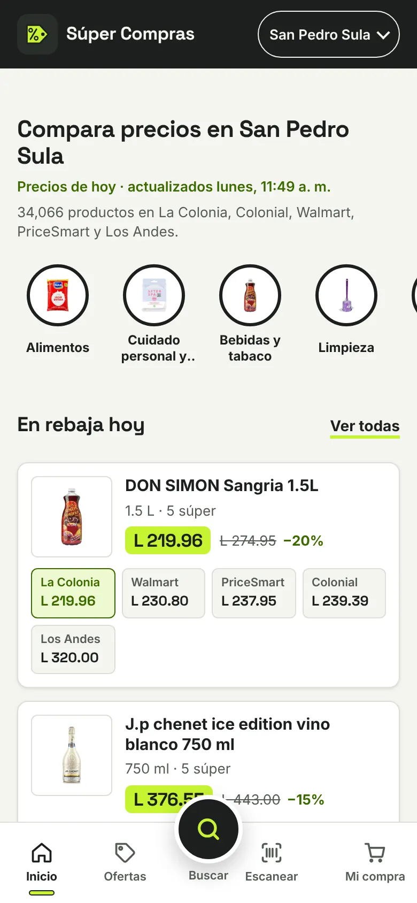
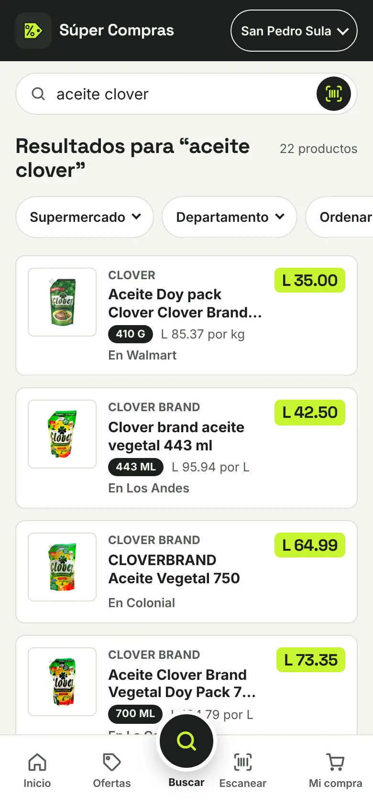
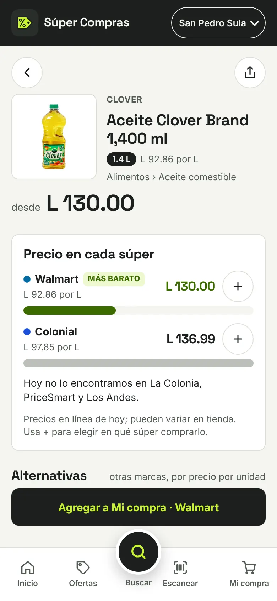
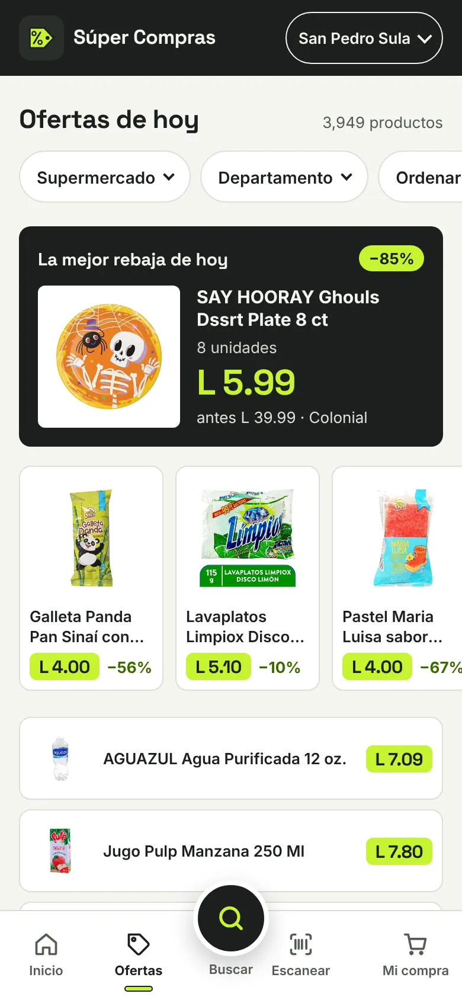
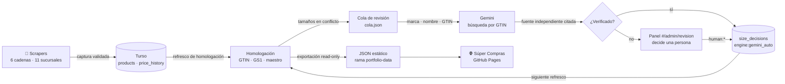
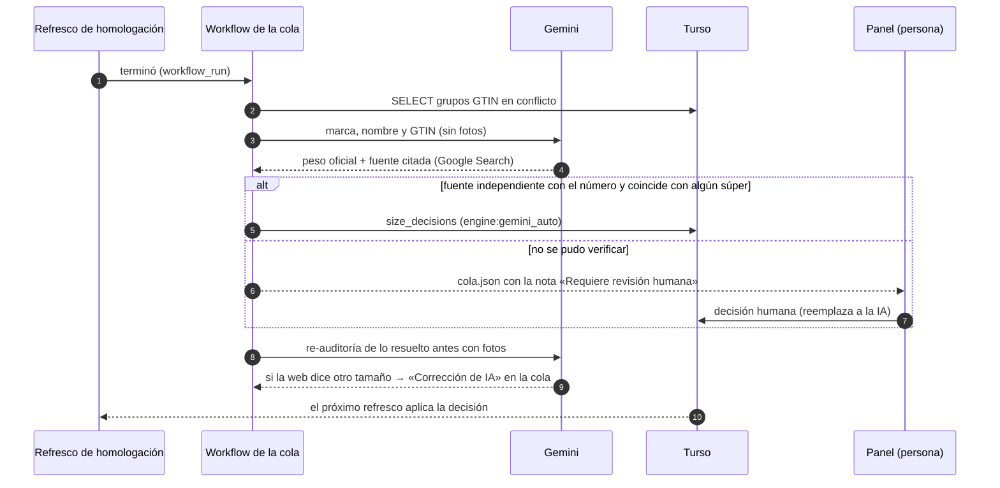
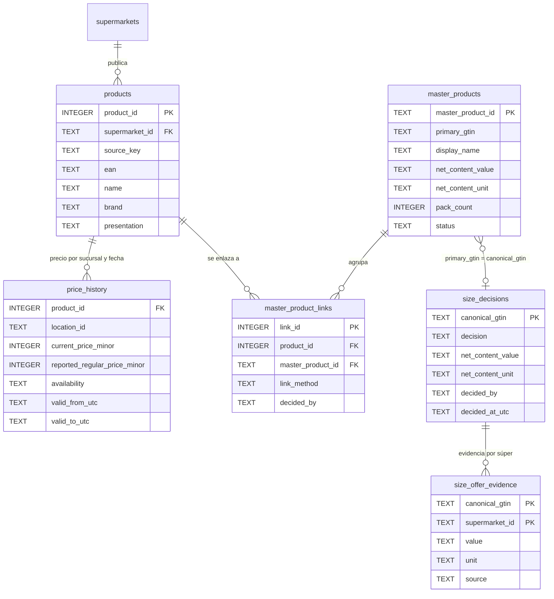

# Súper Compras — precios de supermercados de Honduras

[-003B57?logo=sqlite&logoColor=white)](precios-supermercados-sps/docs/modelo-datos.md)

Captura, validación, homologación y publicación diaria de precios públicos de seis cadenas de supermercados en San Pedro Sula y Tegucigalpa, con la web app **Súper Compras** para compararlos y saber en qué súper conviene hacer la compra.

- **App:** https://jchernandez-portfolio.github.io/precios-supermercados-sps/super-compras/
- **Caso de estudio:** https://jchernandez-portfolio.github.io/Portafolio/precios-supermercados-sps/portfolio/caso/
- **Código y documentación:** [`precios-supermercados-sps/`](precios-supermercados-sps/) — detalle en [`precios-supermercados-sps/README.md`](precios-supermercados-sps/README.md).
- **Ramas de datos:** `portfolio-data` (catálogo público), `product-images` (fotos), `calidad-datos` (registro público de errores), `revision-tamanos` (cola de revisión).
- **Portafolio:** https://jchernandez-portfolio.github.io/Portafolio/

  
  
  
  

## Estado del proyecto

Corte del **18 de noviembre de 2026**. 🟢 funciona solo · 🟡 funciona con trabajo pendiente · 🔴 bloqueado.

| Pieza | Estado | Avance | Detalle |
| --- | :---: | --- | --- |
| Scrapers (6 cadenas, 11 sucursales) | 🟢 | `██████████` 100 % | Corte diario 05:17 con reintento por cadena; persistencia parcial si una falla. |
| Base de datos (Turso / libSQL) | 🟢 | `██████████` 100 % | Último dato válido + histórico compacto; los workflows sólo leen salvo los pasos de guardado. |
| Motor de IA (búsqueda por GTIN) | 🟡 | `███████░░░` 70 % | Gemini busca el peso oficial por GTIN, sin fotos, e ignora los súper de Honduras; aprueba solo lo verificado y re-audita lo resuelto con fotos. Depende de la cuota de Gemini. |
| Panel de revisión de tamaños | 🟡 | `███░░░░░░░` 29 % | 284 de 980 códigos resueltos (216 por la IA, 68 por una persona); 696 en cola (244 empates, 452 atípicos). |
| Frontend Súper Compras | 🟢 | `██████████` 100 % | Diseño Lima, PWA, escáner propio, esqueletos de carga; CSP estricta y cero dependencias. |
| PriceSmart: códigos de barras | 🔴 | `█░░░░░░░░░` 2 % | De 1,823 tarjetas sólo 30 traen GTIN; la foto del catálogo es el frente del empaque. El código está en la galería (foto trasera): falta capturarla. |

## Cómo funciona

Revisión de un código con tamaños distintos (por ejemplo Heinz 566 g contra 20 oz):

## Modelo de datos

Tablas principales en Turso (SQLite). Columnas resumidas; el detalle está en [`docs/modelo-datos.md`](precios-supermercados-sps/docs/modelo-datos.md).

## Cómo decide la IA

- **[Búsqueda web por GTIN](precios-supermercados-sps/README.md#búsqueda-web-por-gtin):** se aprueba solo lo que una fuente independiente (no un súper de Honduras) cita y coincide con algún súper; lo demás queda para una persona.
- **[Ley de la Mayoría](precios-supermercados-sps/README.md#ley-de-la-mayoría):** las lecturas de fotos ya guardadas sólo cuentan si todas dicen lo mismo y es el tamaño de más de la mitad de las ofertas.

## Sobre el repositorio

El proyecto se separó del antiguo monorepo `Portafolio` conservando su historial. Se mantiene dentro de `precios-supermercados-sps/` para que las rutas de workflows, tests y datos sigan funcionando igual.
