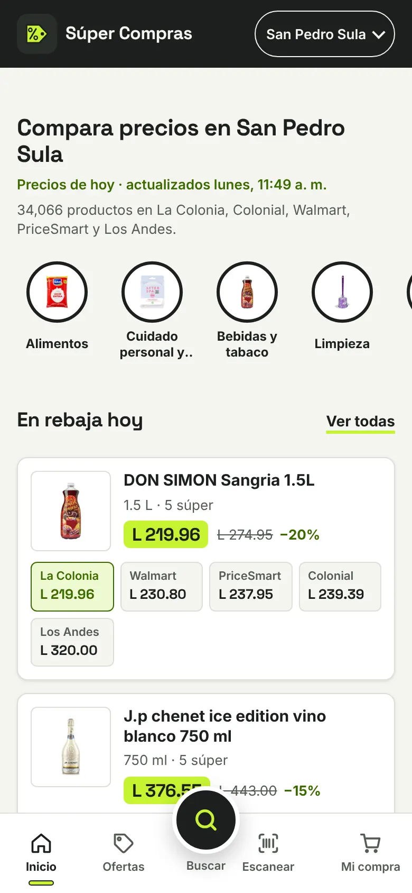
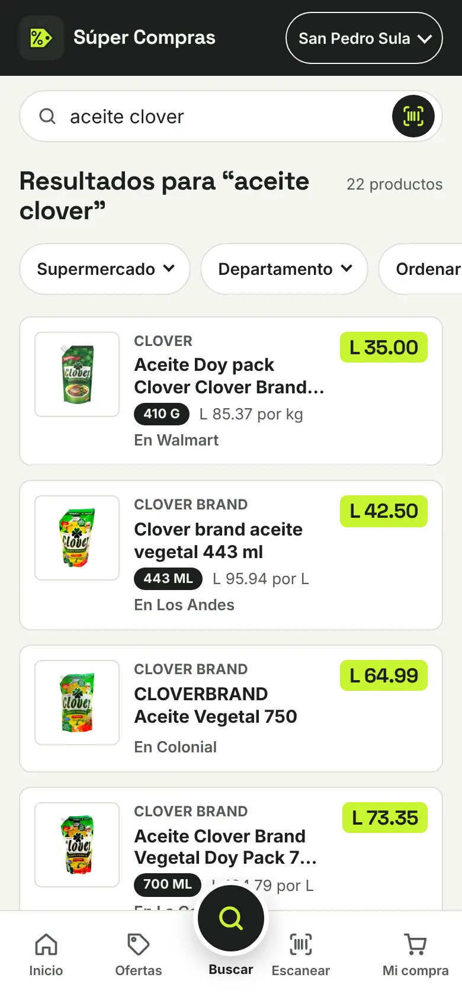
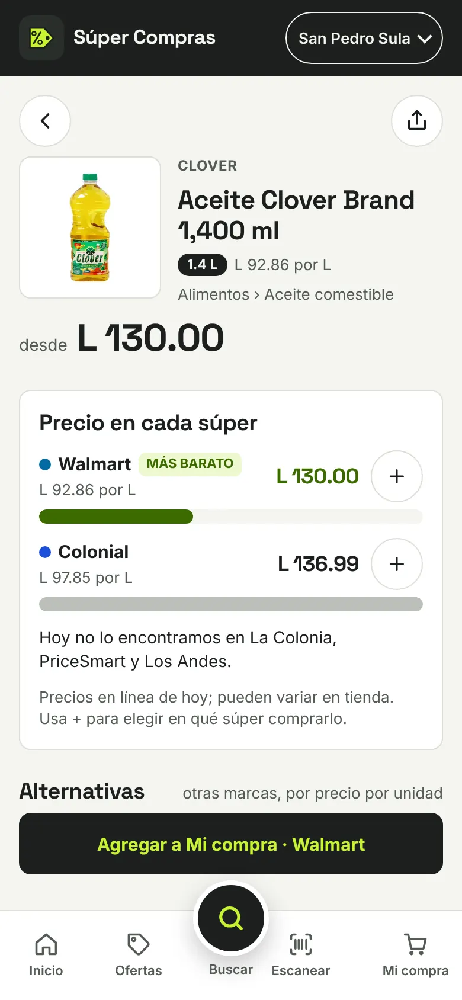
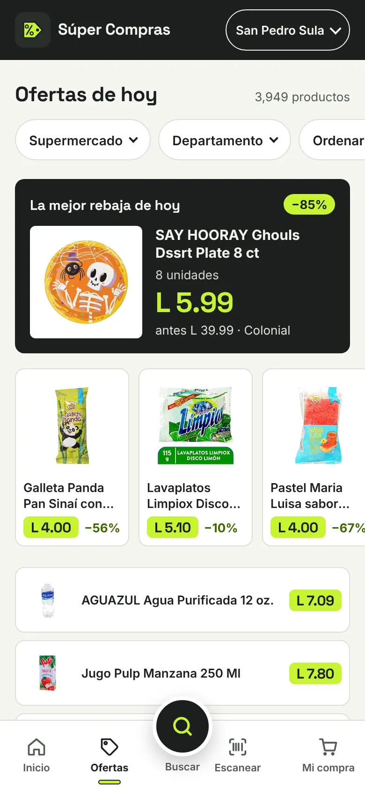

# Súper Compras — precios de supermercados de Honduras

Sistema que **captura, valida, homologa y publica todos los días** los precios públicos de seis cadenas de supermercados en San Pedro Sula y Tegucigalpa, y los presenta en **Súper Compras**, una web app para comparar precios y saber en qué súper conviene hacer la compra.

- **App:** https://jchernandez-portfolio.github.io/precios-supermercados-sps/super-compras/
- **Caso de estudio:** https://jchernandez-portfolio.github.io/Portafolio/precios-supermercados-sps/portfolio/caso/
- **Registro público de errores:** rama [`calidad-datos`](https://github.com/jchernandez-portfolio/precios-supermercados-sps/tree/calidad-datos)
- **Estado operativo vigente:** [`docs/PROJECT_STATE.md`](docs/PROJECT_STATE.md)
- **Estado por pieza, diagramas y modelo de datos:** [README principal](../README.md)

<p align="center">
  
  
  
  
</p>

## Ley de la Mayoría

Cómo decide la lectura de fotos con Claude (`scripts/sugerir_tamanos_ia.py`). Sólo guarda sola cuando **todas** las fotos legibles dicen lo mismo **y** ese tamaño es el que publica **más de la mitad** de las ofertas.

| Situación | Ejemplo | Resultado |
| --- | --- | --- |
| Fotos iguales y tamaño de la mayoría | 4 de 5 súper publican 566 g y las fotos dicen 566 g | ✅ `auto`: se guarda como `engine:claude_auto` y sale de la cola |
| Las fotos no coinciden entre sí | una dice 1 kg y otra 908 g | ⚠️ `conflicto`: decide una persona |
| La foto coincide sólo con una minoría | Mazola: foto 1 kg, mayoría publica 908 g | ⚠️ `conflicto` (`minoria`): decide una persona |
| La foto no coincide con ningún título | foto 5 fl oz, títulos 150 g | ⚠️ `discrepancia`: decide una persona |
| Foto ilegible, de otro producto o sin foto | — | `no_legible` / `sin_foto`: decide una persona |
| Ya existe una decisión humana | — | La IA nunca la reemplaza; la persona sí reemplaza a la IA |

## Búsqueda web con Claude

Para lo que la foto no resuelve, Claude (API de Anthropic, herramienta de servidor `web_search`) busca el peso oficial del fabricante (`scripts/buscar_tamanos_web.py`).

| Regla | Cómo se cumple |
| --- | --- |
| Sólo la cola, nunca el catálogo | Lee `cola.json` en su orden (empates primero; antes, los GTIN pedidos en `web_primero`). Tope de 40 consultas por corrida (máximo 300) y de 60 minutos; hasta 3 búsquedas por producto. |
| Qué se le da | Marca, nombre, GTIN y el tamaño que publica cada súper, con la instrucción de no elegir un tamaño sólo porque lo publica un súper. |
| Se aprueba sola (`engine:claude_auto`) | Sólo si: confianza **alta**, la URL salió de la búsqueda, alguna **cita textual** de la fuente trae el número, y el tamaño coincide con el que publica al menos un súper. Se guarda la forma publicada que coincide (la de más súper). Nunca sobre una decisión humana. |
| Si no se puede verificar | Se queda en la cola con «🤖 Claude no pudo verificar el dato en la web. Requiere revisión humana»; si encontró algo, el panel lo muestra como «🌐 Sugerencia Web» con su fuente. |
| Caché y límites | `web-tamanos.json` en la rama `revision-tamanos`; lo no resuelto se reintenta a los 30 días. Ante 429, llave inválida o búsqueda deshabilitada, para y guarda lo avanzado. |
| Llave | `ANTHROPIC_API_KEY` sólo entra a los dos pasos de IA; el SDK la manda en un encabezado, nunca en URLs ni logs. |

## Cobertura

| Ciudad | Supermercados / sucursales |
| --- | --- |
| San Pedro Sula | La Colonia, Colonial, Walmart, PriceSmart, Comisariato Los Andes |
| Tegucigalpa | La Colonia, Walmart FFAA, Walmart El Sauce, PriceSmart Florencia, Paiz Multiplaza, Paiz Próceres |

Seis cadenas, once sucursales. Corte publicado el **2026-11-16**: 34,066 productos visibles en San Pedro Sula y 27,075 en Tegucigalpa. Las cifras cambian cada día; el valor vigente está en el `manifest.json` de cada ciudad (rama `portfolio-data`) y en el resumen de `calidad-datos`.

## Súper Compras

La app vive en [`super-compras/`](super-compras/) y se publica sola en GitHub Pages de este repositorio en cada cambio (workflow `precios-supermercados-sps-pages.yml`, rama `gh-pages`; Pages sirve esa rama desde la raíz); el portafolio enlaza ahí y la dirección anterior redirige. Es JavaScript sin framework ni dependencias, instalable (PWA) y funciona sin conexión con lo último que cargó. Diseño «Lima» (carbón y lima, Space Grotesk + Inter servidas desde el propio sitio), con esqueletos de carga y movimiento que respeta «reducir movimiento».

- **Inicio:** ofertas del día y hora de la última actualización; si una sucursal no se capturó hoy, lo dice con la fecha de ese precio.
- **Buscar:** búsqueda por producto o marca, filtros por súper y orden por precio; cada tarjeta muestra tamaño y precio por kg, L, libra o unidad.
- **Producto:** el mismo artículo en cada supermercado, con el más barato marcado y otras presentaciones para comparar.
- **Mi compra:** la lista completa con su costo en cada supermercado y comprando cada cosa donde está más barata. Se guarda en el dispositivo.
- **Escanear:** lee el código de barras con la cámara del teléfono (BarcodeDetector o un lector ZXing propio, sin servicios externos) y abre dónde está más barato.
- **Revisión de tamaños** (`#/admin/revision`, interno): mismo código de barras con tamaños distintos entre súper. Claude lee las fotos y resuelve lo claro ([Ley de la Mayoría](#ley-de-la-mayoría)); para el resto busca el peso oficial en internet y aprueba solo lo que la fuente confirma ([búsqueda web con Claude](#búsqueda-web-con-claude)). Una persona decide, y su decisión siempre reemplaza a la de la IA.

La app solo lee archivos estáticos ya publicados (`portfolio-data`, `product-images`). No consulta Turso ni sitios de supermercados desde el navegador, no pide cuenta ni datos personales y tiene una política de seguridad de contenido estricta. La carga inicial pesa ~48 KB (~9 KB gzip, 2 requests) más la portada del catálogo (`home.json`, ~11 KB gzip); el índice de búsqueda (~1.4 MB gzip) baja en segundo plano y las fichas por partición bajo demanda.

## Flujo diario en detalle

```text
Sitios públicos de 6 cadenas (11 sucursales)
  ↓  captura aislada por cadena (Python, Playwright, httpx)
Validación: conteos, identidad y precios deben cuadrar
  ↓  lo contradictorio queda en cuarentena con evidencia
Turso: último dato válido + histórico compacto
  ↓
Homologación: código de barras, contenido neto GS1, precio por libra, categorías
  ↓
Exportación read-only → validación de schema/scope/hash/secretos
  ↓
portfolio-data (catálogo estático por ciudad) → Súper Compras
  ↓
Auditoría de calidad (3 veces al día) → calidad-datos
```

- **Disparo:** 05:17 Honduras desde un Worker de Cloudflare (`edge/daily-trigger`); si no llega, el operador arranca el corte a las 08:17.
- **Reintentos:** si una cadena falla, solo esa se reintenta a las 08:17 y 12:17 (máximo tres intentos).
- **Tamaños:** después de cada refresco se arma la cola de revisión de tamaños (`revision-tamanos`); las decisiones guardadas se aplican en el siguiente refresco y corrigen con evidencia de las fotos («X lo publica como N»).
- **Persistencia parcial:** las cadenas aceptadas se guardan y publican aunque otra falle; la fallida queda STALE y la app muestra la fecha de su último precio.
- **Tolerancias medidas:** el sitemap de Colonial puede llegar atrasado (se acepta hasta 1 % de desfase; `products.json` y las tarjetas siguen exigiendo coincidencia exacta). Un producto de Los Andes con precios contradictorios queda fuera ese día con evidencia (máximo 0.5 % del catálogo). Más allá de esos límites, la captura falla cerrada.

## Homologación

El contenido neto se normaliza con las reglas de GS1 y se aplica igual a todo el catálogo:

| Publicado por el súper | Se muestra | Regla |
| --- | --- | --- |
| Leche Uht Sula Entera 0.946 Lt | 946 ml | contenido neto GS1 |
| Pollo Entero Norteño (código 2…) | precio por libra | peso variable GS1 |
| Rábano Rojo Mazo | 1 unidad | artículo sin medida |
| Dramamine 50 mg caja 24 tabletas | 24 unidades | la dosis no es el peso |

Dos productos de cadenas distintas solo se comparan si comparten identidad fuerte (código de barras o vínculo revisado). Marca + presentación no bastan. Detalle: [`docs/homologation/`](docs/homologation/) y [`docs/COMPARATOR-METHODOLOGY.md`](docs/COMPARATOR-METHODOLOGY.md).

## Calidad de datos

La auditoría ([`scripts/auditar_calidad_catalogo.mjs`](scripts/auditar_calidad_catalogo.mjs), workflow `precios-supermercados-sps-data-quality.yml`) corre a las 07:40, 13:40 y 17:40 de Honduras y después de cada sincronización. Usa la misma lógica que la app y publica en la rama `calidad-datos`:

| Archivo | Contenido |
| --- | --- |
| `README.md` | resumen por ciudad, supermercado y problema, y captura del día por sucursal |
| `errores_detectados.csv` | todo lo que la revisión automática encuentra hoy, con enlace al producto |
| `errores_confirmados.csv` | errores revisados a mano: origen (súper o Súper Compras), estado, solución y PR |
| `historial.csv` | cuántos errores había en cada publicación |
| `frescura.csv` | última captura aceptada de cada sucursal, día a día |

Cuando el súper publica mal un dato, la app sigue tres reglas: **corrige** los patrones seguros (“1100 Lt” → 1.1 L, “397 Oz” que son gramos), **esconde** el tamaño y el precio por unidad si son imposibles y **avisa** la fecha cuando un precio no es del día. El registro manual vive en [`docs/calidad/errores-confirmados.csv`](docs/calidad/errores-confirmados.csv).

## Fotos de producto

Las fotos se descargan de las fuentes públicas, se convierten a WebP y se publican en la rama `product-images`. Detalle y cobertura: [`docs/super-compras-fotos.md`](docs/super-compras-fotos.md).

## Estructura

| Carpeta | Contenido |
| --- | --- |
| `src/precios_supermercados/` | scrapers, validación, persistencia, homologación y exportación |
| `scripts/` | entrypoints de los workflows (captura, publicación, auditoría, fotos) |
| `super-compras/` | la web app |
| `tests/` | pruebas automatizadas (pytest) |
| `docs/` | estado, arquitectura, metodología, calidad y runbooks |
| `edge/` | Worker de Cloudflare que dispara el corte diario |
| `powerbi/` | activos reproducibles del producto analítico B2B |
| `portfolio/` | datos de muestra que sincroniza el portafolio (`sample-data.json`) |
| `reports/` | evidencia de capturas (los archivos grandes viven en releases; ver `reports/EVIDENCIA.md`) |

Ramas de datos: `portfolio-data` (catálogo público), `product-images` (fotos), `calidad-datos` (registro de errores).

## Contratos vigentes

| Contrato | Uso |
| --- | --- |
| `rpi-consumer-catalog/v3` + `rpi-consumer-catalog-manifest/v3` | catálogo público por ciudad que lee Súper Compras |
| `rpi-consumer-city-index/v1` | índice de ciudades (`v3/cities.json`) |
| `rpi-consumer-analysis/v1` | análisis por ciudad |
| `rpi-consumer-mart/v2` | comparación analítica segura |
| `rpi-business-mart/v1` | producto analítico privado para Power BI |
| `rpi-marts-manifest/v1` | integridad de marts |

## Principios

1. La fuente manda; no se inventan precio, ubicación ni atributos.
2. Un corte rechazado no sustituye el último estado comercial válido; la app dice de qué fecha es cada precio.
3. Homologar no equivale a autorizar comparación; marca + presentación no bastan.
4. Los errores se corrigen solo con patrones seguros y quedan registrados.
5. Los datos públicos no contienen secretos, datos crudos ni colas privadas.
6. Solo se usan datos públicos; no se usan APIs privadas.

## Estándar de código y pruebas

Todo cambio entra por PR y debe pasar el workflow de pruebas, que corre en este orden:

```bash
python -m pip check
python -m compileall precios-supermercados-sps/src precios-supermercados-sps/scripts
python -m ruff check precios-supermercados-sps          # Python: reglas en pyproject.toml
npx --yes @biomejs/biome@2.3.5 lint                      # JavaScript: reglas en biome.json (desde precios-supermercados-sps/)
PRECIOS_SPS_EVIDENCIA=descargar PYTHONPATH=precios-supermercados-sps/src pytest -q precios-supermercados-sps/tests
```

- La versión de la app se pone con `scripts/versionar_super_compras.py` (el despliegue a
  Pages la sella sola con fecha + commit).
- Cada PR fusionado se anota en [`CHANGELOG.md`](CHANGELOG.md).
- Las capturas crudas grandes viven en un Release ([`reports/EVIDENCIA.md`](reports/EVIDENCIA.md)).

## Documentación

- Estado actual e incidentes: [`docs/PROJECT_STATE.md`](docs/PROJECT_STATE.md)
- Arquitectura: [`docs/arquitectura.md`](docs/arquitectura.md)
- Calidad de datos: [`docs/calidad/README.md`](docs/calidad/README.md)
- Comparabilidad: [`docs/COMPARATOR-METHODOLOGY.md`](docs/COMPARATOR-METHODOLOGY.md)
- Identidad de producto: [`docs/homologation/product-identity-standard-v1.md`](docs/homologation/product-identity-standard-v1.md)
- Catálogo y marts: [`docs/RPI-DATA-MART-DICTIONARY.md`](docs/RPI-DATA-MART-DICTIONARY.md)
- Fotos: [`docs/super-compras-fotos.md`](docs/super-compras-fotos.md)
- Presentación en el portafolio: [`docs/portfolio-showcase.md`](docs/portfolio-showcase.md)
- Power BI: [`docs/BI-IMPLEMENTATION-GUIDE.md`](docs/BI-IMPLEMENTATION-GUIDE.md)
